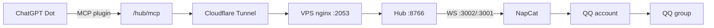

# Deploy from zero — ChatGPT Dot ↔ QQ bridge

This is the sanitized build record. Hostnames, IPs, QQ numbers, and credentials are placeholders.

## Architecture



## 0. Prerequisites

- A Linux VPS with a public IP, nginx, Node 22+, and a domain on Cloudflare.
- A QQ account for the bot and a group the bot has joined.
- A ChatGPT account with access to custom GPTs / dots and plugins.
- The hub source tree (Node service) and its systemd units.

## 1. Public entry (Cloudflare Tunnel)

The origin nginx listens on `:2053` because `:443` is reserved for another TLS service.

```bash
# create a named tunnel
curl -X POST "https://api.cloudflare.com/client/v4/accounts/<ACCOUNT_ID>/cfd_tunnel" \
  -H "X-Auth-Email: <CF_EMAIL>" -H "X-Auth-Key: <CF_KEY>" \
  -d '{"name":"dwgx-hub","config_src":"cloudflare"}'

# ingress: <HUB_DOMAIN> -> local nginx :2053
curl -X PUT "https://api.cloudflare.com/client/v4/accounts/<ACCOUNT_ID>/cfd_tunnel/<TUNNEL_ID>/configurations" \
  -H "X-Auth-Email: <CF_EMAIL>" -H "X-Auth-Key: <CF_KEY>" \
  -d '{"config":{"ingress":[{"hostname":"<HUB_DOMAIN>","service":"https://127.0.0.1:2053","originRequest":{"originServerName":"<HUB_DOMAIN>"}},{"service":"http_status:404"}]}}'

# DNS: CNAME <HUB_DOMAIN> -> <TUNNEL_ID>.cfargotunnel.com, proxied
```

Run the tunnel as a systemd service with `--protocol http2`; allow outbound TCP/UDP `7844` for root.

## 2. nginx

```nginx
server {
    listen 2053 ssl http2;
    server_name <HUB_DOMAIN>;
    ssl_certificate     /etc/letsencrypt/live/<HUB_DOMAIN>/fullchain.pem;
    ssl_certificate_key /etc/letsencrypt/live/<HUB_DOMAIN>/privkey.pem;

    location /hub/ {
        proxy_pass http://127.0.0.1:8766/;
        proxy_http_version 1.1;
        proxy_buffering off;
        proxy_read_timeout 300s;
        proxy_send_timeout 300s;
    }
}
```

If the origin has Host/secret checks, allow `127.0.0.1` (the tunnel) explicitly, or send the expected Host/secret from the tunnel.

## 3. Hub

```bash
# env (excerpt)
HUB_ROOT=/opt/dwgx-capability-hub-r03d
HUB_DATA=/var/lib/dwgx-capability-hub-r03d
HUB_HOST=127.0.0.1
HUB_PORT=8766
QQ_ALLOWED_GROUPS=<GROUP_ID>
QQ_OWNER_IDS=<OWNER_QQ>
NAPCAT_WS_URL=ws://127.0.0.1:3002
HUB_EVENT_SUB_TTL_MS=2592000000   # 30 days
```

Units: `dwgx-hub-r03d-api`, `-worker`, `-qq-adapter`. Secrets live in `<SECRET_PATH>`, never in the repo.

## 4. NapCat / OneBot

- Run NapCat in Docker; publish `127.0.0.1:3001` (OneBot WS) and `127.0.0.1:6099` (WebUI).
- `dwgx-napcat-ws-proxy` listens on `:3002` and relays to the container's `:3001`.
- Log in by scanning the QR from the WebUI (or the startup log).

## 5. ChatGPT plugin

- Plugin URL: `https://<HUB_DOMAIN>/hub/mcp?token=<MCP_TOKEN>`
- Authentication: no-auth; the token rides in the query string.
- Modern MCP is stateless: every result carries `resultType: "complete"`; `initialize` echoes the requested version.
- Ship one stable façade (`hub_call`) and one event façade (`hub.event` + `kind`) so the plugin catalog never needs a rebuild.

## 6. Subscriptions

Subscribe to:

| Event | Filter |
|---|---|
| `qq.message.created` | `group:<GROUP_ID>` |
| `qq.mention.created` | `group:<GROUP_ID>` |
| `qq.private_message.created` | `private:<OWNER_QQ>` |

The hub controls TTL (`HUB_EVENT_SUB_TTL_MS`). Keep it long (30 days) and run a daily renewal job:

```bash
25 3 * * * python3 -c "import sqlite3;c=sqlite3.connect('<HUB_DATA>/db/hub.sqlite');c.execute(\"UPDATE event_subscriptions SET expires_at=datetime('now','+30 days') WHERE active=1\");c.commit()"
```

## 7. Owner rule

Save a narrow custom rule in the Dot UI:

> 向 QQ 群 `<GROUP_ID>` 发送日常聊天回复及普通生成的图片、语音，按该群自然交流需要发送；不包含用户或他人的私人资料、凭据、秘密或敏感个人信息，不包含文件分享、权限变更或其他高影响操作。

Behavior: **Take action without asking**.

## 8. Verify

```bash
curl -s https://<HUB_DOMAIN>/hub/health
curl -s -X POST https://<HUB_DOMAIN>/hub/mcp-open \
  -H 'Content-Type: application/json' \
  -d '{"jsonrpc":"2.0","id":1,"method":"tools/list"}'
curl -s http://127.0.0.1:3011/health        # adapter connected:true
ss -ltn | grep 3001                         # OneBot WS listening
```

## 9. Rollback

- DNS: delete the tunnel CNAME, restore the previous record.
- Tunnel: `systemctl disable --now cloudflared`, delete the tunnel via API.
- Firewall: restore `/etc/nftables.conf.bak-*` and `nft -f`.
- nginx: restore the backup in `/root/nginx-bak-*` and reload.
